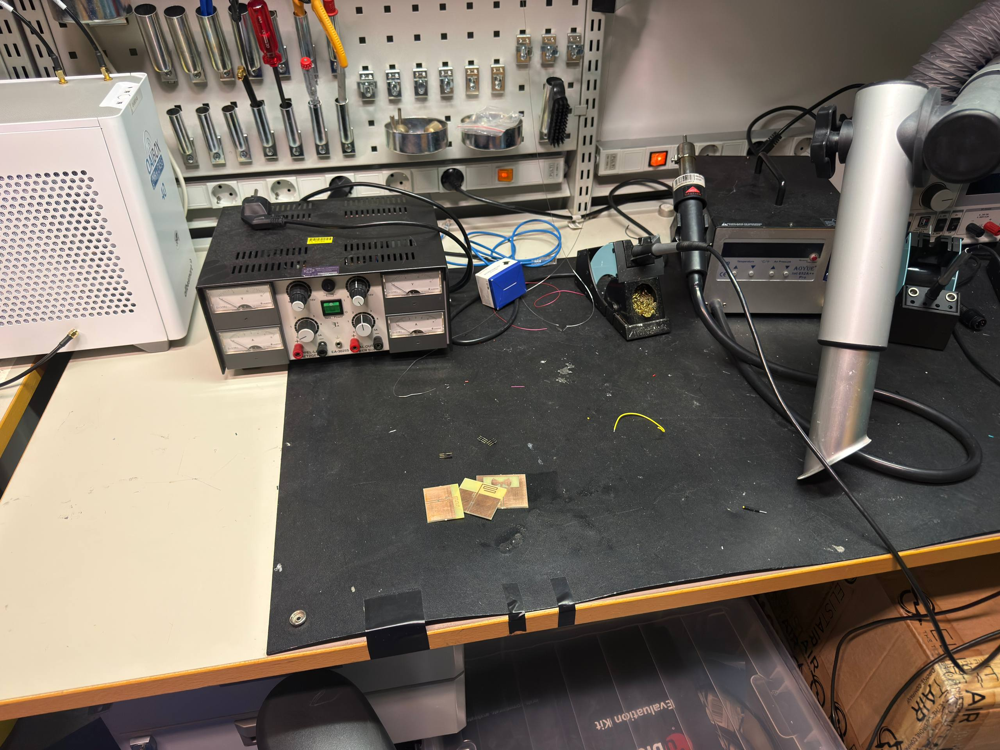
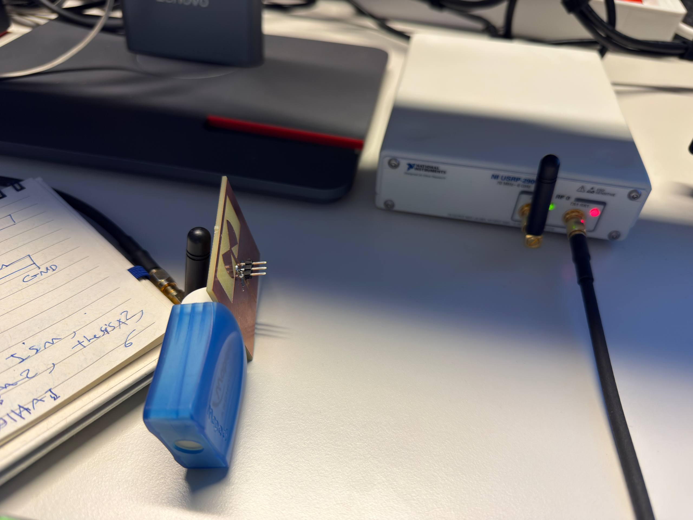
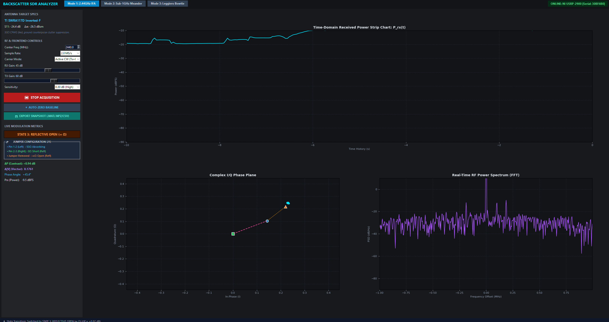
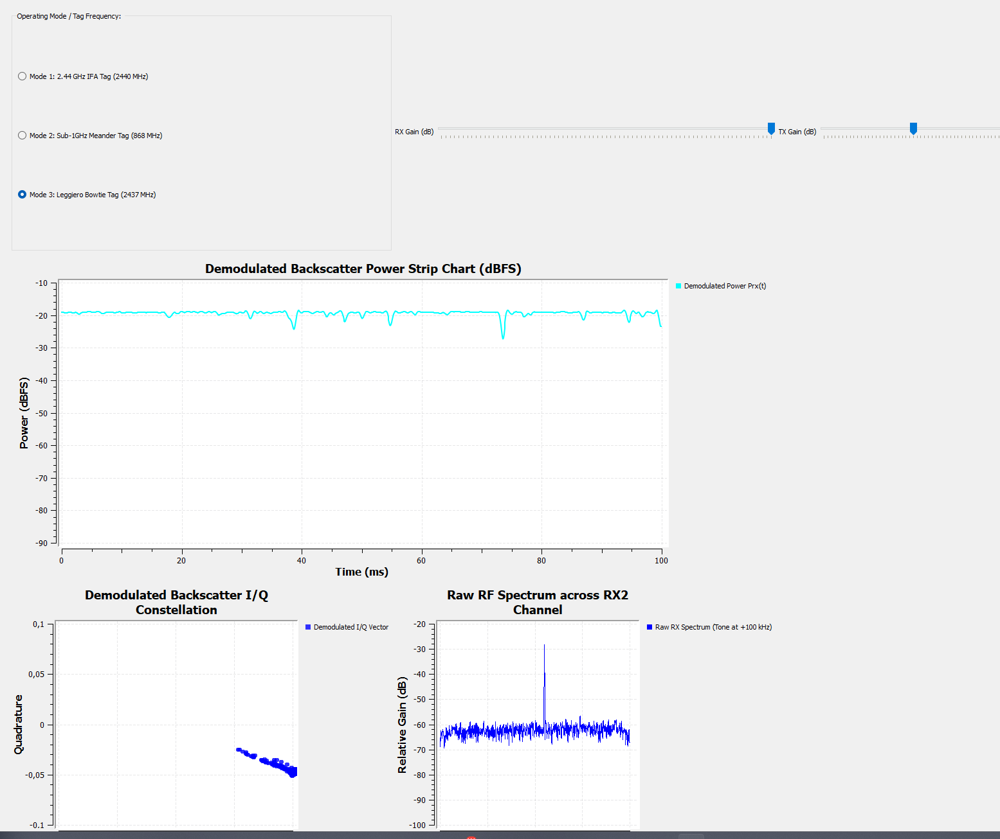
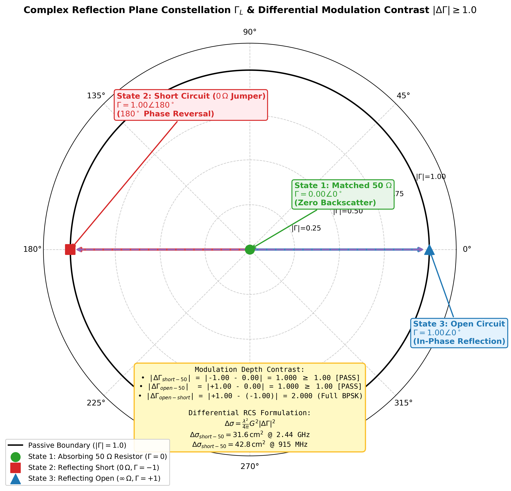
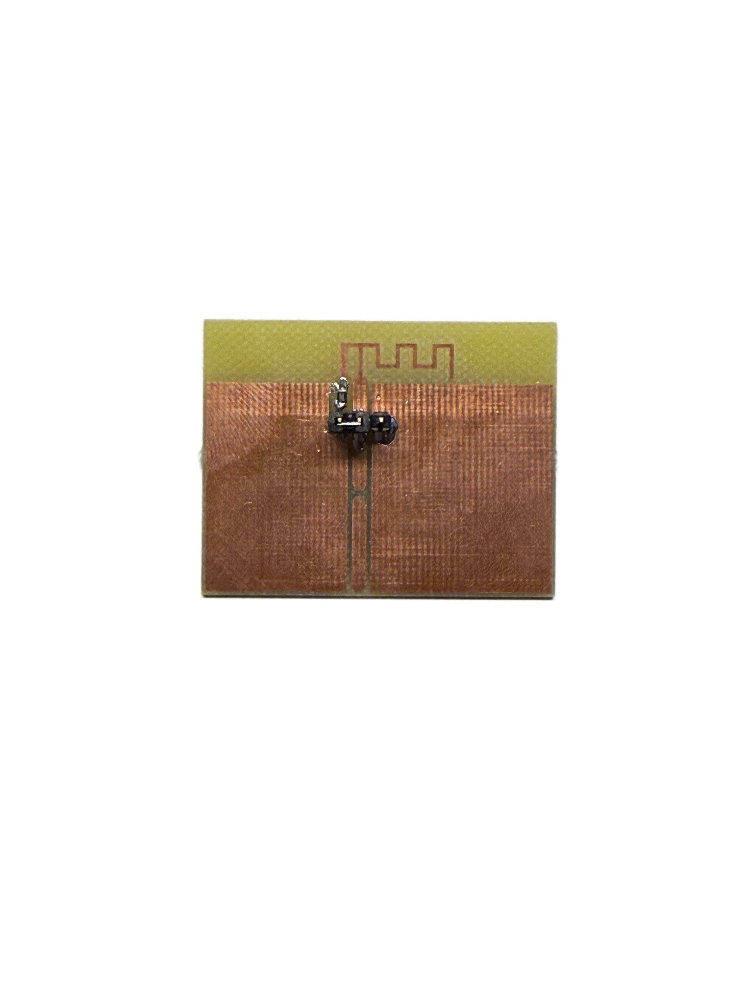
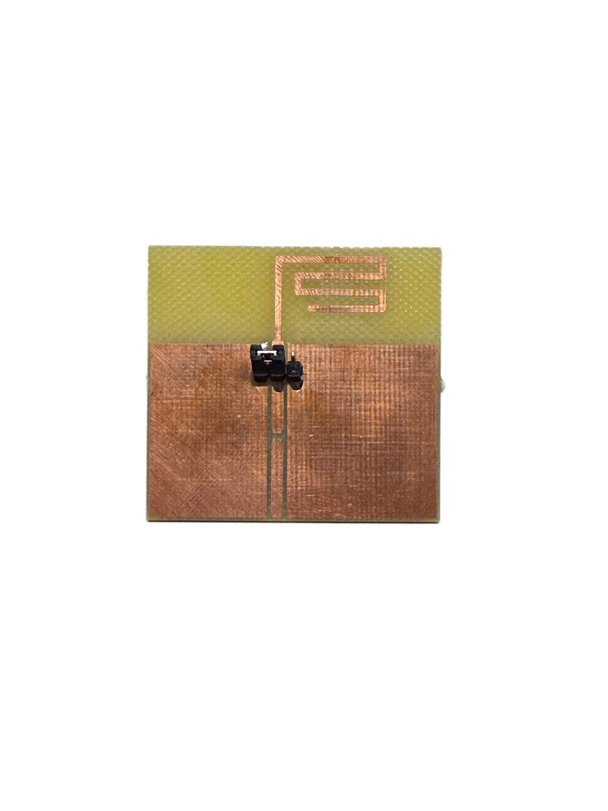
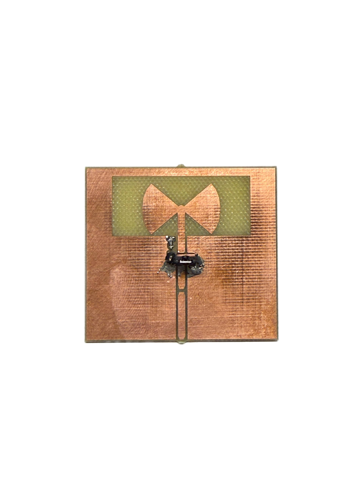

# Single-Sided FR-4 Passive RF Backscatter Tag System

[](LICENSE)
[](https://www.python.org/)
[](https://kicad.org/)
[](https://wiki.gnuradio.org/)
[](https://www.ettus.com/)

An open-source, production-ready research platform for **single-sided, zero-via passive RF backscatter tags** milled on standard 1.6 mm FR-4. The repository packages complete KiCad 9.0 hardware projects, ready-to-mill CAM/Gerber manufacturing packages, an interactive Python Tkinter/Matplotlib real-time SDR acquisition GUI, GNU Radio Companion DSP flowgraphs, electrodynamic simulation solvers, and experimental validation reports.

---

## 📸 System Gallery

| Fabricated Tag Prototypes (Milled Single-Sided FR-4) | Physical Testing Setup (NI USRP-2900 + Tags) |
| :---: | :---: |
|  |  |

| Real-Time Python SDR Dashboard | GNU Radio Vector Phase Constellation |
| :---: | :---: |
|  |  |

---

## ⚡ Operating Principle: Harrington Loaded-Scatterer Theory

The tag modulates incident radio-frequency illumination without an active transmitter or battery. According to **Harrington's theory of loaded scatterers**, terminating an antenna with complex load impedance $Z_L = R_L + j X_L$ controls its reradiated field:

$$\sigma(Z_L) = \left| \sqrt{\sigma_{\text{str}}} - \frac{\lambda}{\sqrt{4\pi}} \frac{R_a}{Z_a + Z_L} \cdot \tilde{g} \right|^2$$

where $\sigma_{\text{str}}$ is the tag's structural radar cross section (metal shape reflection), $Z_a = R_a + j X_a \approx 50\,\Omega$ is the antenna input impedance, $\lambda$ is wavelength, and $\tilde{g}$ is the vector gain pattern.

Each prototype features an on-board 3-pin $2.54\,\text{mm}$ header (`J1`) enabling **3 distinct physical modulation states**:

| State | Physical Termination | Impedance ($Z_L$) | Reflection ($\Gamma$) | RF Physical Action | Constellation Behavior |
| :---: | :---: | :---: | :---: | :---: | :---: |
| **State 1** | $50\,\Omega$ SMD 0805 Resistor | $50\,\Omega$ | $\Gamma \approx 0$ | **Absorb:** Energy dissipates in resistor; minimum backscatter | Constellation origin ($0, 0$) |
| **State 2** | Direct GND short jumper | $0\,\Omega$ | $\Gamma \approx -1 \angle 180^\circ$ | **Reflect:** Full reflection with $180^\circ$ phase inversion | Left phase plane quadrant |
| **State 3** | Open circuit (unconnected) | $\infty\,\Omega$ | $\Gamma \approx +1 \angle 0^\circ$ | **Reflect:** Full reflection in-phase ($0^\circ$) | Right phase plane quadrant |

The differential radar cross section ($\Delta \sigma$) between absorb and reflect is:
$$\Delta \sigma = \frac{\lambda^2}{4\pi} G_a^2 |\Gamma_1 - \Gamma_2|^2$$
Yielding a theoretical $\approx 6\,\text{dB}$ power delta for Absorb vs. Reflect ($|\Delta \Gamma| \approx 1.0$), and a $180^\circ$ phase plane flip for Open vs. Short ($|\Delta \Gamma| = 2.0$).



---

## 🏷️ Fabricated Tag Prototypes & CNC Milling Specifications

All boards are engineered specifically for **single-sided CNC isolation milling** (LPKF ProtoMat or 3018 CNC) with zero plated through-holes:
- **Substrate:** Standard 1.6 mm FR-4 ($\varepsilon_r = 4.4$, $\tan\delta = 0.02$).
- **Copper Foil:** $35\,\mu\text{m}$ (1 oz) single-sided top layer (`F.Cu`), zero vias.
- **Milling Tool:** $0.40\,\text{mm}$ isolation bit with $\ge 0.50\,\text{mm}$ safety clearance and $\ge 0.50\,\text{mm}$ minimum trace width.
- **RF Feedline:** Coplanar Waveguide with Ground (CPWG) with trace width $W = 1.85\,\text{mm}$ and ground gap $G = 0.50\,\text{mm}$ achieving characteristic impedance $Z_0 = 49.0\,\Omega$.

| Parameter | Board 1: 2.44 GHz IFA Tag | Board 2: Sub-1GHz Meander Tag | Board 3: Leggiero Cavity Bowtie Tag |
| :--- | :--- | :--- | :--- |
| **Primary CAD** |  |  |  |
| **Operating Frequency** | $2.440\,\text{GHz}$ (ISM / Wi-Fi) | $868 / 915\,\text{MHz}$ (IoT / RFID) | $2.437\,\text{GHz}$ (Wi-Fi Ch 6) |
| **Antenna Geometry** | Planar Inverted-F (TI SWRA117D derived) | Single-Sided Meander Monopole | Radial Cavity Bowtie Aperture ($80^\circ$ sector) |
| **Board Footprint** | $45.0 \times 35.0\,\text{mm}$ | $45.0 \times 38.0\,\text{mm}$ | $60.0 \times 55.0\,\text{mm}$ |
| **Antenna Envelope** | $15.2 \times 5.7\,\text{mm}$ | $34.0 \times 16.0\,\text{mm}$ ($L_{\text{eff}}=73.5\,\text{mm}$) | $36.0 \times 15.5\,\text{mm}$ (Cavity aperture) |
| **Simulated Gain ($G_a$)**| $+2.1\,\text{dBi}$ | $+0.8\,\text{dBi}$ | $+4.2\,\text{dBi}$ |
| **Return Loss ($S_{11}$)**| $-24.4\,\text{dB}$ | $-19.2\,\text{dB}$ | $-18.6\,\text{dB}$ (Wideband) |
| **Diff. RCS ($\Delta \sigma$)** | $-26.5\,\text{dBsm}$ ($0.0022\,\text{m}^2$) | $-21.8\,\text{dBsm}$ ($0.0066\,\text{m}^2$) | $-22.5\,\text{dBsm}$ ($0.0056\,\text{m}^2$) |
| **Key Advantage** | Compact, standard $50\,\Omega$ IFA | Sub-1GHz zero-via replacement | High forward gain, body proximity shield |
| **Hardware Project** | [`hardware/board1_ifa_2.4ghz/`](hardware/board1_ifa_2.4ghz/) | [`hardware/board2_meander_sub1ghz/`](hardware/board2_meander_sub1ghz/) | [`hardware/board3_cavity_bowtie_2.4ghz/`](hardware/board3_cavity_bowtie_2.4ghz/) |

---

## 📁 Repository Structure

```text
passive-rf-backscatter-tag/
├── hardware/                         # KiCad 9 hardware projects & CAM milling files
│   ├── board1_ifa_2.4ghz/            # Board 1 IFA project, Gerbers, DXF, DRC reports
│   ├── board2_meander_sub1ghz/       # Board 2 Meander Sub-1GHz project & CAM package
│   ├── board3_cavity_bowtie_2.4ghz/  # Board 3 Cavity Bowtie project & CAM package
│   └── scripts/                      # Automated KiCad build & export scripts
│
├── software/                         # Real-time SDR acquisition & detection software
│   ├── backscatter_gui_app.py        # Primary Tkinter + Matplotlib real-time GUI (>300 FPS)
│   ├── mock_usrp.py                  # Physics-grounded synthetic SDR generator
│   ├── sdr_worker.py                 # Multi-threaded UHD / mock acquisition pipeline
│   ├── backscatter_metrics.py        # SCNR, moving average, and centroid algorithms
│   ├── plot_backscatter_results.py   # Offline capture analysis and publication figures
│   └── gnuradio/                     # GNU Radio DSP flowgraphs (.grc and .py)
│
├── simulation/                       # Electrodynamic solvers & mathematical models
│   ├── antenna_models.py             # Analytical models for IFA, Meander, and Bowtie
│   ├── rcs_simulation.py             # Harrington radar cross section solver
│   ├── calc_feedline_impedance.py    # Analytical CPWG 50-Ohm feedline impedance solver
│   ├── calc_meander_dims.py          # Sub-1GHz trace length & meander calculator
│   └── simulate_all.py               # Master sweep script generating S11 & Smith charts
│
├── docs/                             # Academic reports, walkthroughs & visual assets
│   ├── assets/                       # High-resolution photos, captures, & plots
│   ├── hardware_walkthrough.md       # Board fabrication & assembly guide
│   ├── simulation_report.md          # Numerical validation & impedance curves
│   └── software_architecture.md     # SDR architecture & threading model
│
├── tests/                            # Automated pytest verification test suite
│   ├── test_hardware_integrity.py    # DRC, Gerber, and CAM compliance tests
│   ├── test_simulation_models.py     # Antenna modeling and Harrington solver tests
│   └── test_software_mock.py         # SDR mock streaming and GUI lifecycle tests
│
├── launch_backscatter_gui.bat        # 1-Click launcher for SDR GUI Dashboard
├── launch_gnuradio_gui.bat           # 1-Click launcher for GNU Radio QT detector
├── open_gnuradio_companion.bat       # 1-Click launcher for GNU Radio flowgraph editor
├── load_backscatter_data.m           # MATLAB script for publication figure generation
├── requirements.txt                  # Python dependencies
└── README.md                         # This file
```

---

## 🚀 Quick Start Guide

### 1. Prerequisites
- **Python:** 3.9+ with `numpy`, `scipy`, `matplotlib` (install via `pip install -r requirements.txt`).
- **SDR Hardware (Optional):** NI USRP-2900 or Ettus B200 via USB 3.0.
  * *If no SDR hardware is detected, the software automatically transitions to physics-grounded mock streaming without errors.*

### 2. Launching the SDR Acquisition Dashboard

- **Windows 1-Click:** Double-click [`launch_backscatter_gui.bat`](launch_backscatter_gui.bat)
- **Command Line (Live Hardware / Auto-Detect):**
  ```bash
  python software/backscatter_gui_app.py
  ```
- **Command Line (Force Offline Mock Streaming):**
  ```bash
  python software/backscatter_gui_app.py --mock
  ```

### 3. Launching GNU Radio DSP Flowgraph

- **Windows 1-Click:** Double-click [`launch_gnuradio_gui.bat`](launch_gnuradio_gui.bat)
- **Visual GRC Editor:** Double-click [`open_gnuradio_companion.bat`](open_gnuradio_companion.bat)
- **Command Line:**
  ```bash
  python software/gnuradio/backscatter_detector_gnuradio.py
  ```

### 4. Running Electrodynamics Simulations

Execute the electrodynamics engine to recompute $S_{11}$, differential RCS, and Smith chart trajectories:
```bash
python simulation/simulate_all.py
```

### 5. Running Automated Verification Tests

```bash
pytest tests/ -v
```

---

## 🔬 Experimental Findings & Practical Engineering Notes

Fabricating and testing passive backscatter tags in an unshielded lab environment revealed critical insights:

1. **Carrier Leakage vs. Manual Jumper Modulation:**
   - **Direct-Current Carrier Overload:** Because tag modulation operates at the exact incident carrier frequency ($f_c = 2.44\,\text{GHz}$) without a frequency-shifting subcarrier (e.g., no active RF oscillator or MCU clocking an RF switch), the receiver observes the backscatter step directly on top of massive Line-of-Sight (LoS) carrier leakage and static reflections from lab desks, walls, and monitors.
   - **Small Signal over Large Carrier:** The tag reflection represents a tiny millivolt delta superimposed on a massive direct carrier wave.
   - **Manual Jumper Limitations:** Changing physical jumpers introduces human-body hand capacitance and multipath shifts that dwarf the tag's backscatter step. This proved that static DC backscattering with manual jumpers is exceptionally sensitive to environment movements.

2. **DC Step Detection & Receiver Dynamic Range:**
   - In direct-conversion SDR front-ends (AD9361 / USRP B200), hardware DC-offset tracking loops interpret static backscatter state transitions as DC drift and notch them out.
   - **Solution:** Software-defined carrier leakage cancellation via the **Auto-Zero Baseline** button captures a 1-second background snapshot and translates the complex constellation centroid to origin $(0, 0)$.

3. **GNU Radio vs. Python Tkinter Dashboard:**
   - **GNU Radio:** Hardware-accelerated Qt vector sinks and native C++ DSP blocks provide instant, jitter-free observation of phase flips in the IQ plane, making tiny tag reflections distinguishable.
   - **Python GUI:** Provides higher-level engineering automation (instant MATLAB `.mat` export, auto-zeroing, live SCNR calculation, and time-domain power logging).

4. **Human Body Proximity & Ground Border (Board 3):**
   - The cavity ground shield on Board 3 (Leggiero Bowtie) acts as a reflector and RF return path, significantly dampening parasitic detuning when operated near human tissue compared to ground-isolated dipoles.

---

## 📜 License & Citation

This project is licensed under the **MIT License** — see the [LICENSE](LICENSE) file for details.

If you use these tag designs, simulation models, or SDR acquisition tools in your research, please cite:
```bibtex
@misc{jafari2026passivebackscatter,
  author = {Hassan Jafari},
  title = {Single-Sided FR-4 Passive RF Backscatter Tag System: Hardware, SDR Software, and Electrodynamic Modeling},
  year = {2026},
  publisher = {GitHub},
  howpublished = {\url{https://github.com/hjafari890/passive-rf-backscatter-tag}}
}
```
