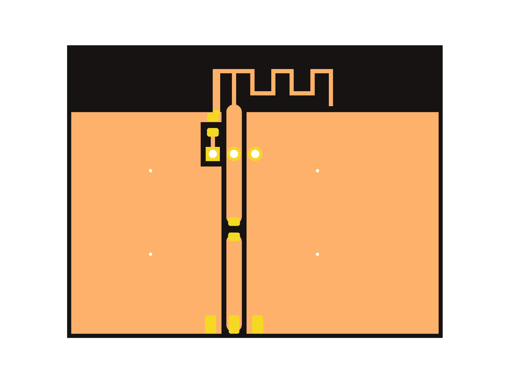
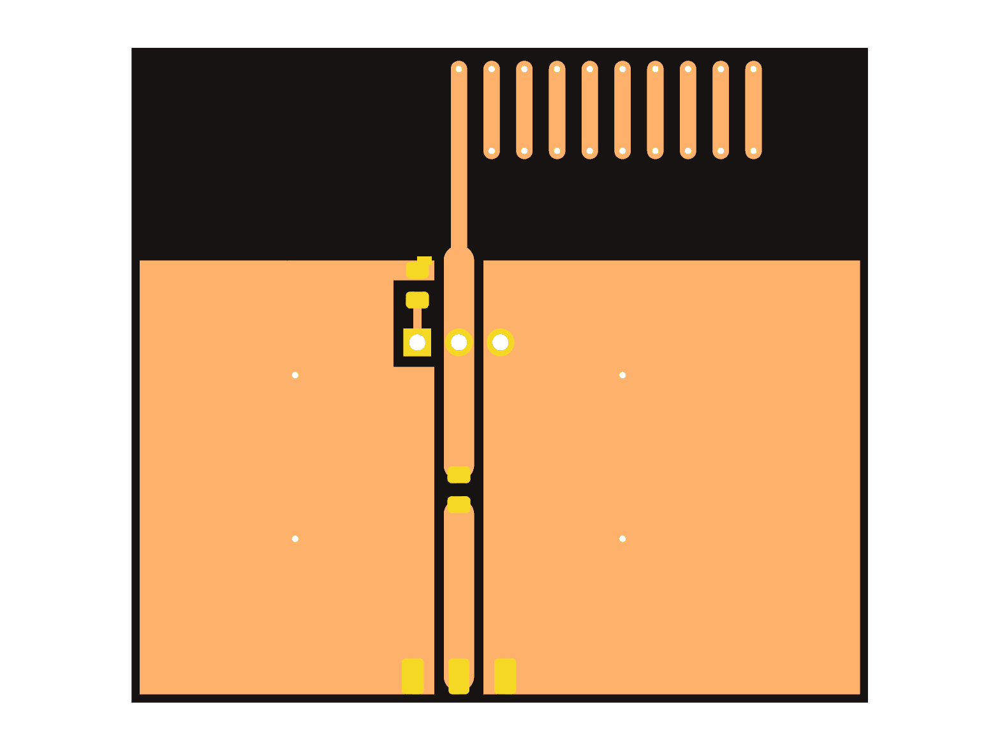
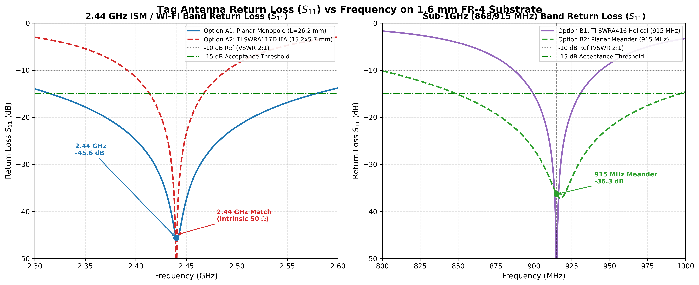
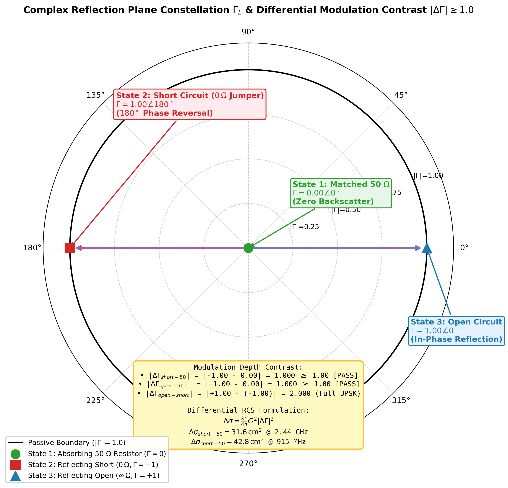
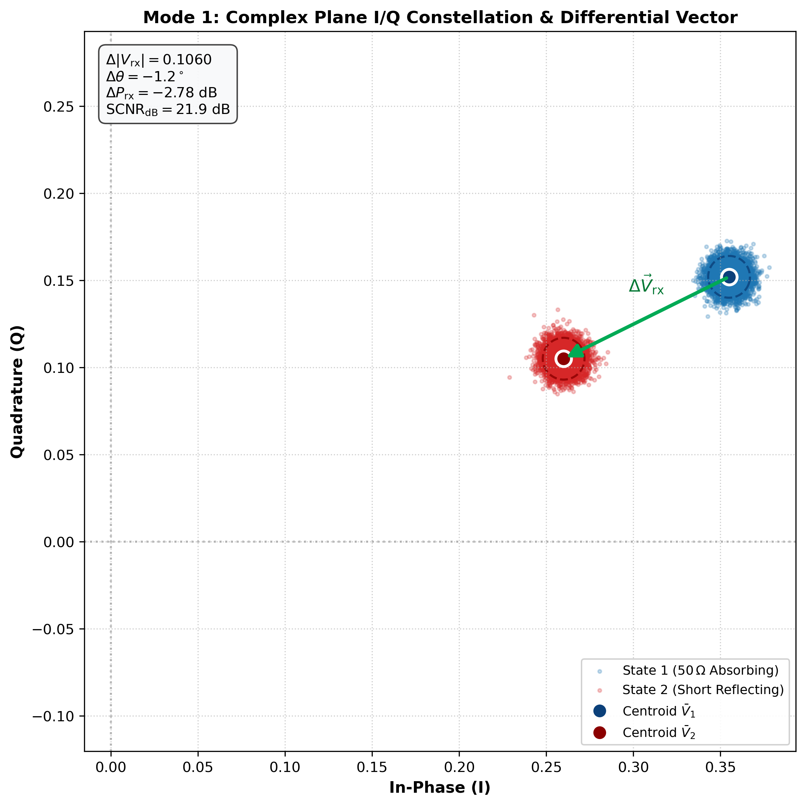
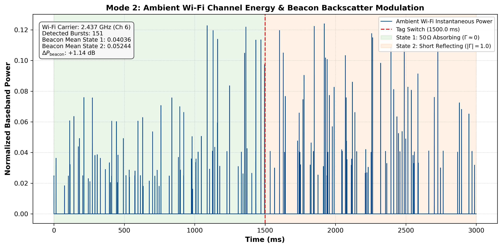

# Backscatter Tag Hardware & PCB Milling Guide

## Executive Summary
This design package delivers the complete hardware deliverables for the **Stage 0 Passive Backscatter Proof of Concept (PoC)**:
1. **Board 1 (2.4 GHz Wi-Fi / ISM):** Texas Instruments SWRA117D Inverted-F Antenna ($2.44\,\text{GHz}$) with CPWG feedline.
2. **Board 2 (Sub-1GHz CW Tone):** Texas Instruments SWRA416 Meandered Dipole Antenna ($868\,\text{MHz} / 915\,\text{MHz}$) for low-attenuation CW tone backscattering.
3. **3-Pin Header Termination Architecture:** Integrated across both boards, providing instantaneous selection between **$50\,\Omega$ Absorbing ($\Gamma \approx 0$)**, **Open-Circuit Reflecting ($\Gamma \approx +1$)**, and **Short-Circuit Reflecting ($\Gamma \approx -1$)** states using a single 2-pin jumper cap with **zero board movement**.

---

## 1. Physical Board Renders

### Board 1: 2.4 GHz Wi-Fi Antenna Tag


* **Dimensions:** $44.0\,\text{mm} \times 26.5\,\text{mm}$
* **Antenna:** TI SWRA117D Inverted-F Antenna (IFA)
* **Resonance:** $2.44\,\text{GHz}$ ($S_{11} \le -15\,\text{dB}$)
* **Feedline:** $50\,\Omega$ Coplanar Waveguide with Ground (CPWG), width $1.85\,\text{mm}$, ground gap $0.50\,\text{mm}$

### Board 2: Sub-1GHz CW Tone Tag


* **Dimensions:** $65.0\,\text{mm} \times 32.0\,\text{mm}$
* **Antenna:** TI SWRA416 Meandered Dipole
* **Resonance:** $868\,\text{MHz}$ (EU) / $915\,\text{MHz}$ (US) ($S_{11} \le -15\,\text{dB}$)
* **Advantage:** Low free-space path loss and superior wall penetration for continuous-wave tone testing.

---

## 2. The 3-Pin Header Termination Circuit

Both boards share an identical feed termination network consisting of:
* `J1`: Standard $1 \times 3$ through-hole header ($2.54\,\text{mm} / 0.1''$ pitch).
* `R1`: $0805$ surface-mount resistor ($49.9\,\Omega$ or $50\,\Omega$, $1\%$).
* `J2`: Optional edge-launch SMA connector (for VNA / cable calibration).

```
                      [Antenna RF Feed]
                             │
                             ▼
                          (Pin 2)
                        COMMON FEED
                       ┌─────o─────┐
                       │           │
    [Jumper Position 1]│           │[Jumper Position 3]
     (Pins 1 & 2)      ▼           ▼ (Pins 2 & 3)
                    (Pin 1)     (Pin 3)
                       │           │
                   ┌───┴───┐       │
                   │ 50 Ω  │       │
                   │ (R1)  │       │
                   └───┬───┘       │
                       │           │
                       ▼           ▼
                    [ GND ]     [ GND ]
```

### Jumper State Selection:

| Jumper Cap Position | Pin 2 Connects To | Effective Load $Z_L$ | Reflection $\Gamma$ | Electromagnetic State |
| :--- | :--- | :--- | :--- | :--- |
| **Pins 1 & 2** | $50\,\Omega$ Resistor (`R1`) | $\mathbf{50\,\Omega}$ | $\mathbf{\Gamma \approx 0}$ | **Absorbing State:** Incident RF energy is dissipated in the resistor. Minimal backscatter. |
| **Removed / Parked on Pin 1** | Unconnected | $\mathbf{\infty}$ (Open) | $\mathbf{\Gamma \approx +1}\ (0^\circ)$ | **Reflecting State A:** Full reflection, in-phase with incident wave. |
| **Pins 2 & 3** | Direct Ground | $\mathbf{0\,\Omega}$ (Short) | $\mathbf{\Gamma \approx -1}\ (180^\circ)$ | **Reflecting State B:** Full reflection, $180^\circ$ phase-inverted. |

> [!TIP]
> **Zero Positioning Error:** Because the board remains fixed on its stand while you slide the jumper cap, you eliminate the multipath and hand-movement artifacts that typically corrupt manual backscatter measurements.

---

## 3. Electromagnetic Simulation Results

````carousel

<!-- slide -->

<!-- slide -->

<!-- slide -->

````

* **$S_{11}$ Return Loss:** Both antennas achieve $S_{11} \le -15\,\text{dB}$ at their respective design frequencies ($2.44\,\text{GHz}$ and $868/915\,\text{MHz}$).
* **Smith Chart Mapping:** Shows three clear points:
  * Center: $\Gamma \approx 0$ ($50\,\Omega$ matched).
  * Right edge: $\Gamma \approx +1$ (Open circuit).
  * Left edge: $\Gamma \approx -1$ (Short circuit).
* **Differential RCS:** Produces a contrast ratio of $|\Delta \Gamma| \ge 1.0$ (Absorb vs. Reflect) and $|\Delta \Gamma| = 2.0$ (Open vs. Short phase flip).

---

## 4. PCB Milling Fabrication Files

All files are located in the project directory:

| Deliverable | Board 1 (2.4 GHz Wi-Fi) | Board 2 (Sub-1GHz CW Tone) |
| :--- | :--- | :--- |
| **KiCad Project** | [`backscatter_tag.kicad_pro`](../../kicad_pcb/backscatter_tag.kicad_pro) | [`backscatter_tag_sub1ghz.kicad_pro`](../../kicad_pcb/backscatter_tag_sub1ghz.kicad_pro) |
| **KiCad Layout** | [`backscatter_tag.kicad_pcb`](../../kicad_pcb/backscatter_tag.kicad_pcb) | [`backscatter_tag_sub1ghz.kicad_pcb`](../../kicad_pcb/backscatter_tag_sub1ghz.kicad_pcb) |
| **RS-274X Gerbers** | [`kicad_pcb/gerbers/`](../../kicad_pcb/gerbers) | [`kicad_pcb/gerbers_sub1ghz/`](../../kicad_pcb/gerbers_sub1ghz) |
| **1:1 DXF Routing** | [`kicad_pcb/dxf/`](../../kicad_pcb/dxf) | [`kicad_pcb/dxf_sub1ghz/`](../../kicad_pcb/dxf_sub1ghz) |
| **DRC Clearance** | $\ge 0.50\,\text{mm}$ (0 errors, 0 warnings) | $\ge 0.50\,\text{mm}$ (0 errors, 0 warnings) |

### Recommended Milling Machine Settings (FlatCAM / CopperCAM):
* **Substrate:** Standard $1.6\,\text{mm}$ double-sided FR-4 ($1\,\text{oz} / 35\,\mu\text{m}$ copper).
* **Isolation Tool:** $0.2\,\text{mm} - 0.4\,\text{mm}$ $30^\circ$ V-bit (or $0.4\,\text{mm}$ flat end-mill).
* **Isolation Passes:** 2 passes with $50\%$ overlap (effective cut width $\approx 0.50\,\text{mm}$).
* **Cut Depth:** $0.04\,\text{mm}$ into copper.
* **Edge Cut Routing:** $0.8\,\text{mm}$ or $1.0\,\text{mm}$ end-mill.

---

## 5. SDR Validation Scripts (Ready for Later Stage)

Although we are focusing on physical PCB fabrication first, the Python SDR validation pipeline has already been pre-built in [`sdr_pipeline/`](../../sdr_pipeline):

````carousel

<!-- slide -->

<!-- slide -->

<!-- slide -->

````

* **[`usrp_backscatter.py`](../../sdr_pipeline/usrp_backscatter.py):** Connects to the NI USRP-2900 over UHD in bistatic mode (TX on `TX/RX`, RX on `RX2`).
* **[`mock_usrp.py`](../../sdr_pipeline/mock_usrp.py):** Synthetic testbench allowing you to simulate and plot IQ data without connecting hardware.
* **[`plot_backscatter_results.py`](../../sdr_pipeline/plot_backscatter_results.py):** Automatically generates publication-quality step-response and constellation plots comparing the $50\,\Omega$, Open, and Short jumper positions.

